  
  
  

### 💻 Sobre mí

- 🚀 Construyo **apps web y PWA** de punta a punta: frontend, API, base de datos, CI/CD y despliegue.
- 🤖 Integro **IA** en productos reales (visión por computadora, flujos agénticos) y uso IA para programar con **reglas y pruebas**, no a ciegas.
- 📚 En **constante aprendizaje**: hoy profundizando en **Docker, Linux y AWS**.
- 🌎 **Open to work**.

### 🛠️ Stack

  

### 🤖 Agentes de IA

  

